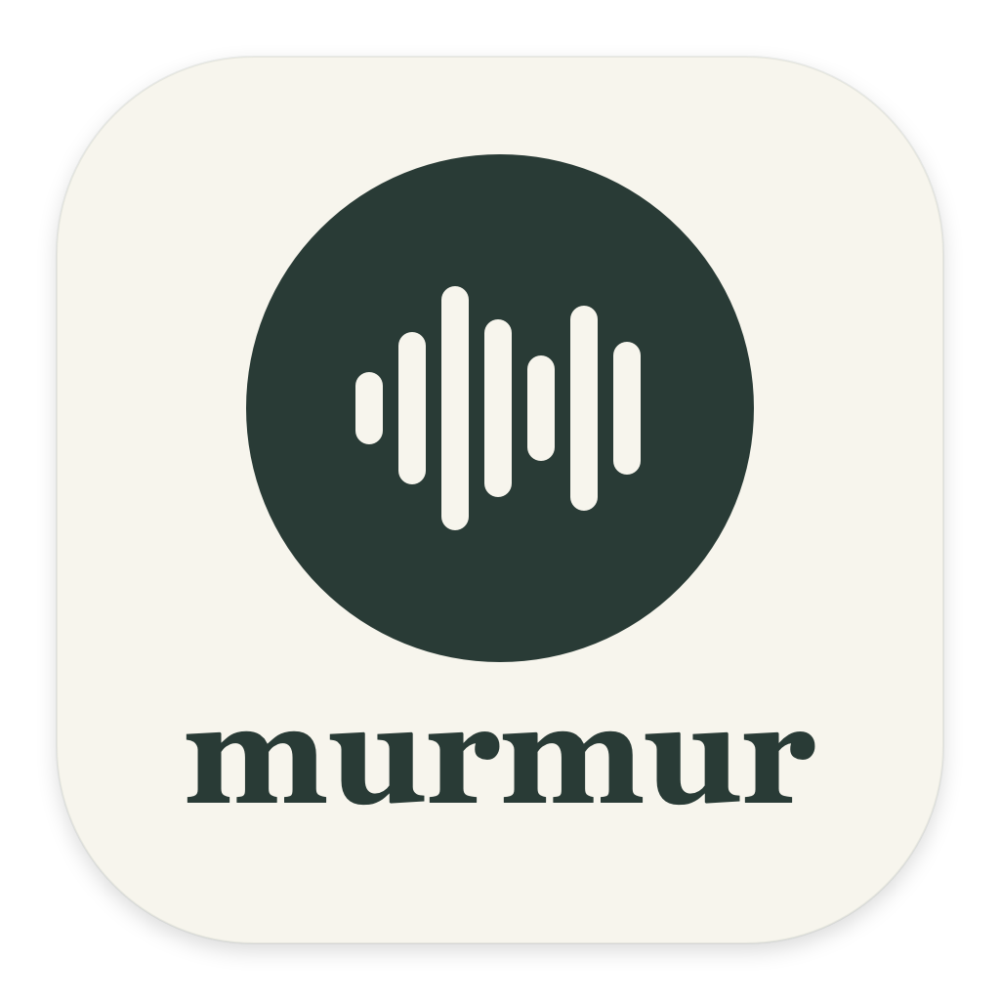

<p align="center">
  
</p>

# Murmur

I built Murmur to listen to Markdown notes on my Mac. I can paste a document, open a `.md` file, and follow along in a rendered preview while speech is generated locally. The interface is native SwiftUI; the neural speech models run in a Python worker through MLX.

## Getting started

I use an Apple Silicon Mac, macOS 14 or later, Apple's Command Line Tools, and [uv](https://docs.astral.sh/uv/). The setup script creates a Python 3.11 environment, installs the speech and Markdown dependencies, and builds the app.

```sh
# Install Apple's Command Line Tools if needed.
xcode-select --install

# Install uv if needed, using Homebrew.
brew install uv

# From the project directory:
./scripts/setup.sh
open build/Murmur.app
```

The app is built and signed locally. It references `.venv` in this project, so I keep the project folder in place. If I move it, I run `./scripts/build.sh` again. This build is not a standalone, notarized installer.

## Reading a document

1. Paste Markdown into **Input**, or use **Open Markdown** / Command-O to import a UTF-8 file.
2. Choose a voice and set the pace. **Heart · American · Kokoro** is the default.
3. Click **Start listening**, press Command-Return, or click a passage in **Preview**.
4. Use Pause, Resume, and Stop to control playback. I stop reading before editing the source.

Preview renders headings, nested lists, emphasis, tables, quotes, and fenced code. A pale green highlight follows the current speech passage. **Follow reading** scrolls to that passage; scrolling manually turns Follow off so I can browse elsewhere.

To jump ahead, I click another passage or select text and choose **Read from selection**. Reading starts at the beginning of the containing speech passage and continues through the document. Highlighting follows passages rather than individual words.

Code blocks stay visible in Preview but are skipped during speech unless **Read code blocks** is enabled. Link labels, image alt text, inline code, and table cells are read aloud. Link destinations, raw HTML, and YAML front matter are skipped. Remote images and embedded HTML are not loaded in Preview.

My current draft and pronunciation dictionary are saved in the app's local macOS preferences. Voice, model, dictionary, and code settings apply to the next reading. Pace changes apply immediately. The model choice is saved between launches.

## Keyboard shortcuts

Open **Help → Keyboard Shortcuts…** in the macOS menu bar to see the assigned keys.

| Shortcut | Action |
| --- | --- |
| Space / Command-Return | Start, pause, or resume reading |
| Command-S | Start or stop playback |
| S | Stop playback |
| I / Command-I | Switch to Input and focus the editor |
| Escape | Leave the editor and enable single-key shortcuts |
| [ / Command-[ | Decrease pace by 0.25× |
| ] / Command-] | Increase pace by 0.25× |
| Command-P | Toggle Input / Preview |
| Command-F | Toggle Follow reading |
| Command-Left / Command-Right | Previous / next passage during reading |
| Command-O | Open Markdown |

Single-key shortcuts leave normal typing intact when an editable text field has focus. Escape leaves the editor; Command shortcuts work while typing. Command-S starts or stops reading; it does not save a file (the draft is saved automatically). Passage navigation preserves the paused state and stays within the document. They apply only to the active Murmur window and are suspended while a sheet is open. Pace changes apply immediately and stay within 0.5×–2×. Editing the document stops the current reading.

## Local speech engines

| Engine | Model / source | Voices in Murmur |
| --- | --- | --- |
| Kokoro | `mlx-community/Kokoro-82M-bf16` | Heart, Bella, Michael, Emma, George |

Kokoro is the local neural engine, with American Heart (`af_heart`) selected by default. Its [official voice catalogue](https://huggingface.co/hexgrad/Kokoro-82M/blob/main/VOICES.md) lists American and British English voices and separate Hindi voices, but no dedicated Indian English voices. Murmur offers Kokoro voices only.

The worker loads Kokoro on demand and keeps it resident for subsequent passages. After one minute without app input while stopped or paused, Murmur terminates the worker to release its model, Python runtime, and GPU memory. Typing, clicks, dragging, and scrolling in the app reset the countdown; active playback never unloads the worker. If document preparation or synthesis is in flight, release waits for its response without restarting the countdown. Paused playback keeps its exact position, current audio, prepared next passage, and pronunciation text. Resume plays prepared audio and reloads the worker on demand for later passages, which can introduce a wait. Starting a new reading also reloads the worker and model. It generates short passages and buffers at most one future passage. Playback can wait between passages if generation falls behind. Stopping cancels playback immediately; an in-flight calculation can still finish before the next request is handled. Quitting terminates the worker.

Kokoro uses `mlx-community/Kokoro-82M-bf16`. The model downloads on first use.

The larger window and reduced margins give Input and Preview more room. Use **Expand document** in the document header to hide the sidebar; **Show voice controls** restores it. The window supports resizing and macOS full screen.

Kokoro generates at its normal pace; the audio player adjusts playback rate immediately, including buffered passages. Actual latency and memory use depend on the machine, available memory, and document content; I have not established an M1 Air performance benchmark.

The first use downloads model files from Hugging Face into:

```text
~/Library/Caches/MarkdownVoice/huggingface
```

After the required model and voice assets are cached, inference runs locally. Document text is not uploaded. I try the voices I need before going offline.

### Passage audio cache

Open **Audio cache…** in the sidebar to choose a maximum size: 100 MB, 250 MB, 500 MB, 1 GB (default), 2 GB, 5 GB, or 10 GB. The selected limit is saved between launches. The panel shows space used and the number of saved passages. Lowering the limit removes the least recently played WAVs immediately. **Clear Cache** stops reading, discards prepared audio, and deletes saved passage WAVs after any in-flight generation finishes. Downloaded models are kept.

There is no time-based expiry. Audio stays reusable until it is evicted to fit the size limit, explicitly cleared, or removed by macOS. Successful playback and resume mark a WAV as recently used; prefetch alone does not. There is no repeating cleanup timer: storage is checked when the worker starts, the limit changes, new audio is saved, or the cache panel refreshes. A WAV larger than the chosen limit plays normally without being saved.

Generated passages are saved in `~/Library/Caches/MarkdownVoice/audio`. Each WAV filename is a SHA-256 identifier covering the exact pronunciation-adjusted spoken text, voice, synthesis speed, engine, model identifier, and cache format version. Normal playback, next-passage buffering, navigation, and reopening the same Markdown all check for saved audio before calling the model. File renaming or moving does not affect reuse. Changing pronunciation or voice produces a different entry. Playback pace is applied by the player, so changing pace reuses the same normal-speed WAV. The playback status identifies **Playing saved audio** or **Playing generated audio**.

**Private audio** bypasses both reading and writing the persistent audio cache. Changing it stops reading so previously prepared speech cannot carry over. Existing cached audio stays until cleared. This setting applies only to speech audio: the draft and pronunciation dictionary are still saved normally. Private playback still uses temporary WAVs, which are removed after loading into the player or stopping; crashes can leave temporary files behind.

Playback always owns a separate temporary copy, so Stop, completion, navigation, and idle worker termination preserve saved WAVs. Repeated passages start faster and avoid inference work. Cached replay still starts the lightweight Python worker for document preparation and lookup, but does not load Kokoro. Corrupt entries are regenerated on demand.

Tradeoffs: storage is bounded by the selected limit for persistent WAVs, while playback copies and model downloads consume additional space. Spoken content can remain locally recoverable indefinitely until eviction or clearing; hashed filenames do not encrypt it. Small text or passage-boundary changes require new audio. Updating weights at the same model identifier requires bumping `AUDIO_CACHE_VERSION` in the worker to avoid reusing older audio.

## Technical pronunciation

I use **Pronunciation dictionary…** to control acronyms, framework names, and unfamiliar phrases without changing the displayed document. Each line defines a whole-term, case-sensitive replacement:

```text
API = A P I
JSON = jay son
JPA = J P A
SQL = sequel
@GetMapping = get mapping
```

I can change `SQL = sequel` to `SQL = S Q L`, or add a phonetic spelling for a name. The optional technical cleanup separates camelCase words and reads common operators aloud. These rules work with every Kokoro model. Neural speech can still mispronounce technical vocabulary, so I keep the dictionary available for each model.

## Development

```sh
# Rebuild after editing Swift or Python sources.
./scripts/build.sh

# Run Markdown, rendering, alignment, and pronunciation tests.
.venv/bin/python -m unittest discover -s tests -v

# Check shortcut routing and typing protection.
.venv/bin/python scripts/check_shortcuts.py

# Check idle release and restart with an accelerated timeout.
.venv/bin/python scripts/check_idle.py

# Check paused audio retention, idle release, resume, and in-flight races.
.venv/bin/python scripts/check_paused_idle.py
# On machines without an audio output device, simulate playback timing.
.venv/bin/python scripts/check_paused_idle.py --headless
# Optional: repeat with actual Kokoro speech and model reload.
.venv/bin/python scripts/check_paused_idle.py --neural

# Exercise real speech generation and write a sample WAV.
.venv/bin/python scripts/check_neural.py

# Check cache controls and preferences without loading the neural model.
.venv/bin/python scripts/check_cache_controls.py

# Check the app's local signature.
codesign --verify --deep --strict build/Murmur.app
```

The speech check writes `build/kokoro-bf16-sample.wav` and verifies that generated audio is nonempty and non-silent. Kokoro also supports Preview highlighting in the desktop app. The test suite covers Markdown cleanup, rendered structure, speech anchors across formatting, unsafe HTML, pronunciation replacements, cache reuse, size-based eviction, private audio, and clear-cache behavior.

`requirements.txt` pins the direct dependencies and compatible tokenizer helpers. `requirements.lock` records the full installed Python environment. For a complete dependency reproduction, I can install the lock file into a Python 3.11 environment with `uv pip install --python .venv/bin/python -r requirements.lock`.

### App icon

I use the dark green waveform mark for the desktop icon, with the Murmur name shown by macOS beneath it. The icon is drawn with AppKit at each macOS icon size. To regenerate it:

```sh
mkdir -p .cache/clang
swift -module-cache-path .cache/clang scripts/generate_icon.swift Assets
iconutil -c icns Assets/Murmur.iconset -o Assets/Murmur.icns
./scripts/build.sh
```

I keep the generator, PNG preview, and `.icns` asset in Git. The intermediate `.iconset` directory is generated and ignored.

### Project layout

```text
Assets/                      App icon and README preview
Sources/MarkdownVoice.swift  SwiftUI interface, playback, and worker lifecycle
Sources/MarkdownPreview.swift Local Markdown preview and reading navigation
backend/document.py          Markdown rendering, speech anchors, pronunciation
backend/worker.py            JSON-lines worker for Kokoro
scripts/                     Setup, build, icon generation, and speech checks
tests/                       Markdown and pronunciation regression tests
```

### Working with Git

```sh
git status
git log --oneline

# Stage only the files relevant to a change, then describe that change.
git add path/to/changed-file
git commit -m "Describe the change"
```

I keep virtual environments, model caches, generated app bundles, audio samples, and recovered reading drafts out of Git. The repository contains source, dependencies, tests, assets, and setup instructions.

## Dependencies and model licenses

Murmur uses [MLX Audio](https://github.com/Blaizzy/mlx-audio), [Kokoro weights](https://huggingface.co/mlx-community/Kokoro-82M-bf16), [Misaki](https://github.com/hexgrad/misaki), and [markdown-it-py](https://github.com/executablebooks/markdown-it-py). Their code, models, and voice assets retain their respective licenses.
